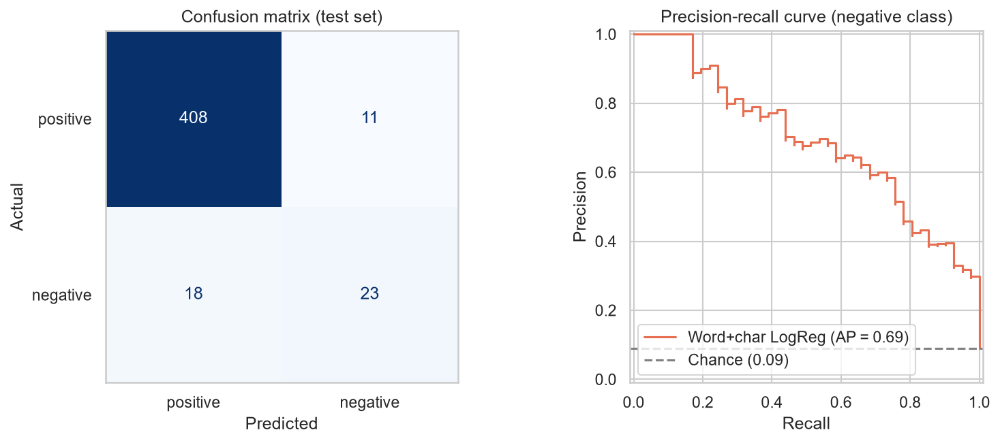
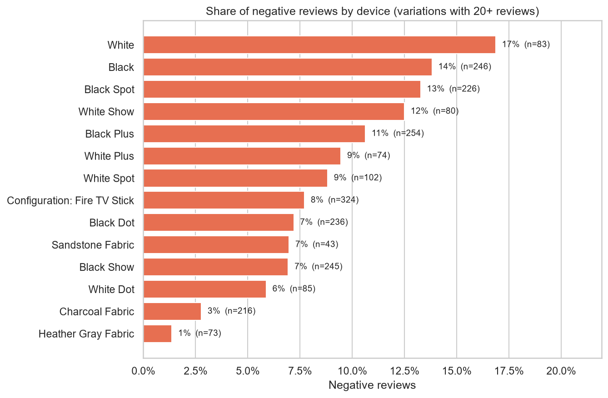
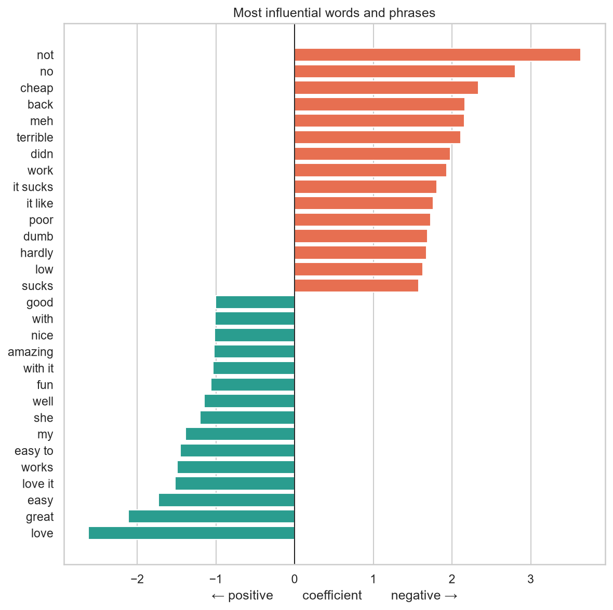

# Amazon Alexa Reviews — Sentiment Analysis

Exploratory analysis and sentiment classification of ~3,000 verified Amazon customer reviews for Alexa devices (Echo, Echo Dot, Echo Show, Echo Spot, Echo Plus and Fire TV Stick).

**Goal:** understand what drives customer dissatisfaction, and build a model that flags negative reviews from their text alone.

➡️ **[Read the full analysis notebook](notebooks/amazon_alexa_reviews.ipynb)**



## Results

Scores for the *negative* class on a held-out test set of 460 unseen reviews:

| Model | Precision | Recall | F1 | PR-AUC |
|---|---|---|---|---|
| Majority-class baseline | 0.00 | 0.00 | 0.00 | 0.09 |
| **TF-IDF (word + char n-grams) + Logistic Regression** | **0.68** | **0.56** | **0.61** | **0.69** |

The final model was picked from five candidates using 5-fold cross-validation. Its test-set scores closely match the cross-validated ones.

| Model (5-fold CV) | F1 | PR-AUC |
|---|---|---|
| Bag-of-words + Naive Bayes | 0.29 | 0.46 |
| Word TF-IDF + Logistic Regression | 0.54 | 0.60 |
| Word + char TF-IDF + Linear SVM | 0.60 | 0.66 |
| **Word + char TF-IDF + Logistic Regression** | **0.61** | **0.66** |

## Key findings

- **91% of reviews are positive.** A model that always predicts "positive" is 91% accurate and useless. Evaluation therefore uses precision, recall, F1 and PR-AUC for the negative class rather than accuracy.
- **A quarter of the dataset was duplicate review text.** Left in, 37% of test reviews also appeared in training and inflated F1 from 0.61 to 0.69. All results here are on deduplicated data.
- **Dissatisfaction varies by device.** The fabric-finish Echos have 1–3% negative reviews, while the plain Black/White variations and the Echo Spot/Show have 12–17%.
- **Unhappy customers write twice as much** (median 31 words vs 15), and their complaints are mostly about devices that don't work, connect or understand.
- **The model's errors are interpretable.** It misses understated, factual complaints, and is confused by mixed 3–4 star reviews that spend most of their words on a complaint.

<p align="center">
  
  
</p>

## Approach

1. **Cleaning.** Removed blank reviews and exact-duplicate review texts (after confirming no duplicate carried conflicting labels), and normalised device names.
2. **EDA.** Looked at the rating distribution, negative-review rate by device, and review length by sentiment.
3. **Modelling.** Used a stratified 80/20 split and compared five models with 5-fold stratified CV on the training set: majority baseline, Naive Bayes, logistic regression (word TF-IDF), and logistic regression / linear SVM (word + character TF-IDF). Class weighting was used to handle the imbalance, followed by a regularisation sweep.
4. **Evaluation.** Ran a single evaluation on the held-out test set, then inspected learned coefficients and analysed misclassified reviews.

`rating` is never used as a model input: the dataset's `feedback` label is derived directly from it (1–2★ → negative, 3–5★ → positive).

## Project structure

```
├── data/
│   └── amazon_alexa_reviews.csv      # raw dataset (3,150 reviews, May–Jul 2018)
├── images/                           # figures exported by the notebook
├── notebooks/
│   └── amazon_alexa_reviews.ipynb    # full analysis
└── requirements.txt
```

## Running it locally

```bash
git clone https://github.com/Arei1997/Amazon-Reviews.git
cd Amazon-Reviews

python -m venv .venv
source .venv/bin/activate        # Windows: .venv\Scripts\activate
pip install -r requirements.txt

jupyter notebook notebooks/amazon_alexa_reviews.ipynb
```

All randomness is seeded, so re-running the notebook reproduces the numbers above.

## Dataset

[Amazon Alexa Reviews](https://www.kaggle.com/datasets/sid321axn/amazon-alexa-reviews) (Kaggle). Verified customer reviews of Amazon Alexa products, with star rating, date, product variation and a binary feedback label.

| Column | Description |
|---|---|
| `rating` | Star rating (1–5) |
| `date` | Review date |
| `variation` | Device model / finish |
| `verified_reviews` | Review text |
| `feedback` | 1 = positive (3–5★), 0 = negative (1–2★) |

## Built with

Python · pandas · scikit-learn · matplotlib · seaborn · Jupyter
